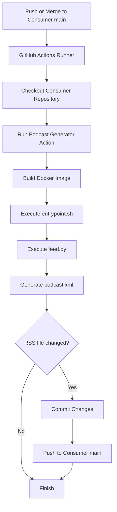

# 🎙️ Podcast Generator — GitHub Docker Action

A reusable GitHub Action that automatically generates a Podcast RSS 2.0 feed from a YAML configuration file using Python, PyYAML, and Docker.

The action can also commit and push the generated `podcast.xml` file back to the repository that invokes it.

## 1. Overview

Podcast Generator simplifies the creation of podcast RSS feeds by automating the transformation of structured YAML data into XML.

**Key features**

- Generate RSS 2.0 XML from `feed.yaml`.
- Support podcast metadata and episode information.
- Execute consistently inside a Docker container.
- Integrate with GitHub Actions workflows.
- Commit and push updated RSS files automatically.
- Skip commits when the generated XML has not changed.
- Reuse the same generator across multiple podcast repositories.

**Important:** This action generates and updates RSS files. It does not independently deploy a GitHub Pages website.

## 2. Architecture

The solution separates the reusable generator from the repository containing podcast data.

```text
Provider Repository
KukeitChanahan/podcast-generator
│
├── action.yml         # GitHub Action metadata and inputs
├── Dockerfile         # Container runtime
├── entrypoint.sh      # Execution, commit and push logic
├── feed.py            # YAML-to-XML conversion logic
├── README.md          # Documentation
└── LICENSE            # MIT License


Consumer Repository
KukeitChanahan/podcast-test
│
├── .github/
│   └── workflows/
│       └── main.yml   # Calls the reusable Action
│
├── feed.yaml          # Podcast configuration
└── podcast.xml        # Generated RSS feed
```

### Execution flow



## 3. Requirements

Before using this action, ensure the following requirements are satisfied:

- A GitHub repository containing a valid `feed.yaml`.
- GitHub Actions enabled.
- GitHub-hosted Ubuntu runner.
- Permission to execute the external action.
- `contents: write` permission if automatic commits are enabled.
- A repository configuration that permits the workflow to push to its target branch.

The Docker image installs Python, Git, and PyYAML automatically. Users do not need to install these dependencies manually on the GitHub-hosted runner.

## 4. Action Inputs

| Input | Required | Default | Description |
|---|---|---|---|
| `name` | No | `github-actions[bot]` | Git commit author name |
| `email` | Yes | None | Git commit author email |

These inputs set Git commit metadata. They do not provide GitHub authentication.

### Example

```yaml
with:
  name: "KukeitChanahan"
  email: "kukeit.ch@gmail.com"
```

For automated operations, using the GitHub Actions bot identity instead of a personal identity is recommended for clearer auditing.

## 5. Quick Start

### Step 1 — Create a consumer repository

Create a GitHub repository to store your podcast configuration.

For example:

```text
podcast-test/
├── .github/workflows/main.yml
└── feed.yaml
```

### Step 2 — Add feed.yaml

Create a file named `feed.yaml` in the root directory.

The example below illustrates the fields expected by the accompanying Python generator.

```yaml
title: "Hackly Technology Podcast"
format: "audio"
subtitle: "AI, software engineering and cloud technology"
author: "Kukeit Chanahan"
description: "A technology podcast about AI and software development."
image: "cover.jpg"
language: "en-us"
link: "https://example.com/podcast/"
category: "Technology"

items:
  - title: "Episode 1 - Introduction to AI"
    description: "An introduction to artificial intelligence."
    duration: "10:30"
    published: "Mon, 16 Nov 2026 08:00:00 GMT"
    file: "episode1.mp3"
    length: "10485760"
```

Replace the example URL and media metadata with your actual values.

The referenced image and MP3 files must be accessible at the URLs generated by `feed.py`.

**Note:** The exact YAML schema depends on your current `feed.py` implementation. This example assumes the generator uses `yaml_data['items']`, `yaml_data['link']`, and the other fields shown above.

### Step 3 — Create a GitHub Actions workflow

Create:

`.github/workflows/main.yml`

```yaml
name: Generate Podcast Feeds

on:
  push:
    branches: [main]

permissions:
  contents: write

jobs:
  build:
    runs-on: ubuntu-latest

    steps:
      - name: Checkout Repo
        uses: actions/checkout@v4

      - name: Run Feed Generator
        uses: KukeitChanahan/podcast-generator@main
        with:
          name: "KukeitChanahan"
          email: "kukeit.ch@gmail.com"
```

The `@main` reference is suitable for initial experimentation. For a stable release, replace it with a published version tag or a pinned commit SHA.

Verify the actual name of your action repository. If the repository is named `postcast-generator` rather than `podcast-generator`, update the `uses:` reference accordingly.

### Step 4 — Commit and push

Create a feature branch:

```bash
git switch main
git pull --ff-only origin main
git switch -c feature/setup-podcast
```

Stage and commit the required files:

```bash
git add feed.yaml .github/workflows/main.yml

git commit -m "Configure podcast generator"

git push -u origin feature/setup-podcast
```

Open a Pull Request from `feature/setup-podcast` into `main`.

Review and merge the Pull Request. This triggers the workflow when the `main` branch is updated.

### Step 5 — Verify the workflow

Open:

**GitHub Repository → Actions → Generate Podcast Feeds**

Select the latest workflow run and inspect its execution logs.

A successful execution should:

1. Checkout the consumer repository.
2. Build the Docker action.
3. Execute the generator.
4. Generate `podcast.xml`.
5. Commit and push the XML if it has changed.

A successful run without a new commit is normal when `podcast.xml` has not changed.

## 6. How the Docker Action Works

### 6.1 Dockerfile

```dockerfile
FROM python:3.10-slim

RUN apt-get update && \
    apt-get install -y --no-install-recommends git && \
    rm -rf /var/lib/apt/lists/*

RUN python -m pip install --no-cache-dir PyYAML

COPY feed.py /usr/local/bin/feed.py
COPY entrypoint.sh /entrypoint.sh

ENTRYPOINT ["/bin/sh", "/entrypoint.sh"]
```

The Dockerfile creates an environment with the dependencies required to execute the generator.

| Instruction | Purpose |
|---|---|
| `FROM` | Select the Python base image |
| `RUN apt-get` | Install Git |
| `RUN pip` | Install PyYAML |
| `COPY` | Copy application files into the image |
| `ENTRYPOINT` | Specify the startup script |

### 6.2 entrypoint.sh

```bash
#!/bin/sh
set -eu

echo "=== Podcast Generator ==="

: "${GITHUB_WORKSPACE:?GITHUB_WORKSPACE is required}"
: "${INPUT_EMAIL:?Email input is required}"

cd "$GITHUB_WORKSPACE"

git config --global --add safe.directory "$GITHUB_WORKSPACE"
git config user.name "${INPUT_NAME:-github-actions[bot]}"
git config user.email "$INPUT_EMAIL"

python /usr/local/bin/feed.py

git add -- podcast.xml

if ! git diff --cached --quiet; then
  git commit -m "Update Podcast Feed"
  git push origin HEAD:main
else
  echo "No podcast.xml changes"
fi

echo "=== Completed ==="
```

The entrypoint performs the following operations:

- Accesses the consumer repository workspace.
- Configures Git commit metadata.
- Executes the Python feed generator.
- Stages only `podcast.xml`.
- Checks whether the generated file has changed.
- Commits and pushes changes when required.

This version assumes the consumer workflow runs on the `main` branch and is permitted to push to it.

### 6.3 action.yml

```yaml
name: "Podcast Generator"
author: "Kukeit Chanahan"
description: "Generate a podcast RSS feed from YAML"

inputs:
  name:
    description: "Git commit author name"
    required: false
    default: "github-actions[bot]"

  email:
    description: "Git commit author email"
    required: true

runs:
  using: "docker"
  image: "Dockerfile"

branding:
  icon: "git-branch"
  color: "red"
```

`action.yml` defines the reusable action's public interface, supported inputs, and Docker runtime configuration.

## 7. Testing

### 7.1 Test the Python generator locally

From a directory containing `feed.yaml`, run:

```bash
python -m pip install PyYAML
python /path/to/feed.py
```

Check the generated XML:

```bash
python -c "import xml.etree.ElementTree as ET; ET.parse('podcast.xml'); print('XML OK')"
```

This checks whether the XML is well-formed. It does not validate all RSS 2.0 or podcast platform requirements.

### 7.2 Test the complete GitHub Action

Test the following scenarios:

| Test case | Expected result |
|---|---|
| Valid YAML | XML generated successfully |
| Updated YAML | XML changed and committed |
| Unchanged YAML | No new commit created |
| Missing YAML | Workflow fails |
| Missing required email | Action exits with an error |
| Restricted push permission | Push fails visibly |
| Invalid podcast data | Validation should reject it when implemented |

## 8. GitHub Pages Deployment

This action does not deploy a website by itself.

If you use GitHub Pages, configure the publishing process separately.

A successful XML commit does not guarantee that GitHub Pages has published the newest feed.

In particular, commits pushed by a workflow using the default `GITHUB_TOKEN` do not normally trigger another push-based workflow or a new branch-based Pages build.

For reliable automatic deployment, consider generating the RSS file and deploying the Pages artifact in the same deployment workflow.

Example output URLs after deployment:

```text
https://YOUR_USERNAME.github.io/podcast-test/

https://YOUR_USERNAME.github.io/podcast-test/podcast.xml
```

These are examples, not verified live URLs.

## 9. Troubleshooting

| Problem | Possible cause | Suggested action |
|---|---|---|
| Action not found | Incorrect repository name or ref | Verify the `uses:` value |
| Docker build failed | Dockerfile or package issue | Review build logs |
| `feed.yaml` not found | Incorrect working directory | Check `GITHUB_WORKSPACE` |
| `INPUT_EMAIL` missing | Required input not provided | Add `with.email` |
| Git unsafe repository error | Workspace ownership mismatch | Configure the correct `safe.directory` |
| Push rejected | Insufficient permissions or branch rules | Review token permissions and repository rules |
| No changes to commit | Generated XML is unchanged | No action required |
| Website not updated | Deployment not triggered | Inspect GitHub Pages configuration |

## 10. Security Considerations

- Apply least-privilege permissions to `GITHUB_TOKEN`.
- Avoid hardcoding passwords, Personal Access Tokens, or other secrets.
- Use GitHub Secrets for sensitive configuration.
- Review Branch Protection Rules before allowing automated pushes.
- Avoid force-pushing to protected branches.
- Prefer pinned versions of third-party actions for production workloads.
- Validate YAML data before processing it.
- Consider using a bot identity for automated commits.
- Review generated XML before publishing it publicly.

### Production design recommendation

A more reusable architecture would separate feed generation from repository modification.

Under that design, the Docker Action generates `podcast.xml`, while the consumer workflow decides whether to commit, upload, or deploy the result.

This reduces coupling between the generator and the Git branch strategy.

## 11. Versioning and Releases

GitHub Actions can be referenced by branch, tag, or commit SHA.

For development:

```yaml
uses: KukeitChanahan/podcast-generator@main
```

For a published release, after creating the corresponding tag:

```yaml
uses: KukeitChanahan/podcast-generator@v1.0.0
```

For production environments with stronger supply-chain requirements, prefer pinning a reviewed full commit SHA.

Recommended release process:

1. Update the action source code.
2. Run tests.
3. Create a Pull Request.
4. Review and merge into `main`.
5. Create a release tag.
6. Update consumer workflows deliberately.

## 12. Rollback Procedure

If a new action release fails, restore the consumer workflow to a previously tested action tag or commit SHA.

If a generated feed is incorrect, correct or revert the underlying YAML or generator logic before rerunning the action. Otherwise, the workflow may regenerate the same incorrect XML.

Prefer reverting through Pull Requests rather than rewriting the history of a shared `main` branch.

## 13. Development Roadmap

Potential future improvements:

- Automated unit tests for `feed.py`.
- Validation of required YAML fields.
- Podcast RSS schema and metadata validation.
- XML formatting and consistency checks.
- Configurable output file paths.
- Configurable target branch.
- Separate Generate and Commit/Push responsibilities.
- GitHub Pages deployment integration.
- Semantic versioning and tagged releases.

## 14. References

- [GitHub Actions Documentation](https://docs.github.com/en/actions)
- [Creating a Docker Container Action](https://docs.github.com/en/actions/tutorials/create-actions/create-a-docker-container-action)
- [GitHub Actions Metadata Syntax](https://docs.github.com/en/actions/reference/workflows-and-actions/metadata-syntax)
- [Automatic Token Authentication](https://docs.github.com/en/actions/security-guides/automatic-token-authentication)
- [Dockerfile Reference](https://docs.docker.com/reference/dockerfile/)

---

## License

This project is licensed under the MIT License. See the [LICENSE](LICENSE) file for details.

## Author

**Kukeit Chanahan**

GitHub: [KukeitChanahan](https://github.com/KukeitChanahan)

---

*Built as a practical learning project for GitHub Actions, Docker, Python, CI/CD automation, and reusable software components.*
